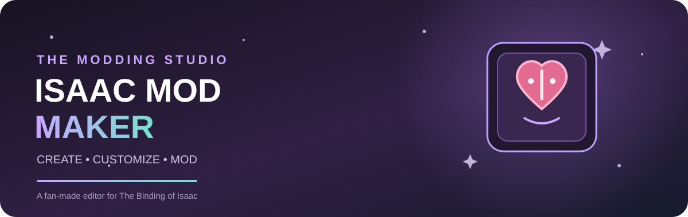

🎮 Isaac Mod Maker

  

  <strong>A browser-based mod creation studio for The Binding of Isaac: Repentance+</strong>

  
  
  
  

---

✨ About

Isaac Mod Maker is a fan-made web application designed to make creating mods for The Binding of Isaac: Repentance+ easier and more accessible.

Create custom items, characters, enemies, and rooms using visual editors, configure properties, upload textures, edit Lua scripts, and get help from an AI assistant.

The goal is to make mod development accessible on both mobile devices and desktop computers.

🚀 Features

💎 Item Editor

- Create custom items with names, descriptions, and IDs.
- Choose item types and configure properties.
- Enable or disable effects using checkboxes.
- Upload custom textures and preview sprites.
- Add custom properties and parameters.
- Edit Lua code manually.

👤 Character Editor

- Configure character stats and starting items.
- Design custom abilities.
- Manage character sprites and animations.
- Customize gameplay behavior with Lua.

👾 Enemy Editor

- Configure health, damage, speed, and behavior.
- Design custom attacks and abilities.
- Import custom enemy textures.
- Create advanced behavior using Lua scripts.

🗺️ Room Editor

- Build room layouts using a grid.
- Place doors, enemies, obstacles, and rewards.
- Customize room types and dimensions.
- Preview room designs visually.

🤖 AI Assistant

- Generate item and character concepts from descriptions.
- Suggest stats, effects, and properties.
- Generate and modify Lua code.
- Help identify common coding errors.
- Let users review and edit generated code.

AI features may require an external API and are subject to implementation and configuration.

💻 Lua Code Editor

- Write custom scripts directly.
- Modify generated code.
- Add custom gameplay mechanics.
- Inspect and customize generated mod files.

📦 ZIP Mod Builder

The planned build system will:

1. Validate project settings and required files.
2. Generate Lua scripts and metadata.
3. Collect textures and other resources.
4. Assemble the mod folder structure.
5. Package the finished mod into a downloadable ZIP archive.

The resulting archive will be intended for installation on a compatible game version.

🛠️ Technology Stack

Technology| Purpose
HTML5| Application structure
CSS3| Responsive interface and visual design
JavaScript| Editors and application logic
Lua| Game mod scripting
JSON| Project storage and configuration
SVG / PNG| Icons, banners, and textures
ZIP| Distribution of completed mods

📱 Platform Support

Isaac Mod Maker is designed for:

- Android phones and tablets.
- Desktop and laptop browsers.
- GitHub Pages hosting.

The interface will adapt to different screen sizes, making it convenient to develop projects without requiring a PC.

📂 Project Structure

isaac-mod-maker/
├── index.html
├── style.css
├── app.js
├── manifest.json
├── README.md
├── assets/
│   ├── banner.svg
│   └── icons/
├── editors/
│   ├── items.js
│   ├── characters.js
│   ├── enemies.js
│   └── rooms.js
├── ai/
│   ├── assistant.js
│   └── prompts.js
├── code/
│   ├── lua-editor.js
│   └── generator.js
└── textures/

💾 Project Files and Exports

Isaac Mod Maker will support two distinct formats:

- JSON — saves and transfers editable projects between sessions.
- ZIP — packages the generated mod files for download and installation.

Project files and finished mod archives serve different purposes and will be handled separately.

🌐 Run the Web App

GitHub Pages

1. Upload the project files to your repository.
2. Open Settings → Pages.
3. Select Deploy from a branch.
4. Choose the "main" branch and the "/(root)" folder.
5. Save and wait for deployment to finish.

Open the published GitHub Pages URL to use the editor.

Local Development

Open "index.html" in a browser. Some features may require a local web server or additional configuration.

🗺️ Development Roadmap

- [x] Initial project structure
- [x] Basic editor prototype
- [ ] Improved item editor and texture selection
- [ ] Character and enemy editors
- [ ] Visual room editor
- [ ] Advanced Lua code editor
- [ ] AI assistant integration
- [ ] Project validation
- [ ] ZIP mod packaging
- [ ] Compatibility testing with supported game versions

⚠️ Project Status

Isaac Mod Maker is currently in early development.

Some features described above are planned and are not yet implemented. Generating a ZIP archive does not automatically guarantee that a mod will work; generated files must follow the requirements of the target game version and be tested in-game.

📜 Disclaimer

Isaac Mod Maker is an independent, fan-made project and is not affiliated with or endorsed by the creators or publishers of The Binding of Isaac.

All game-related names and assets belong to their respective owners. Users are responsible for ensuring that their mods comply with applicable terms and permissions.

❤️ Contributing

Ideas, bug reports, and feature suggestions are welcome!

Help make mod creation more accessible to the Isaac community.

---

  <strong>✨ Create something new. Change the game. ✨</strong>

